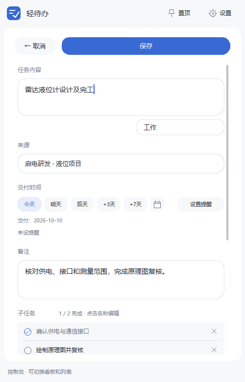
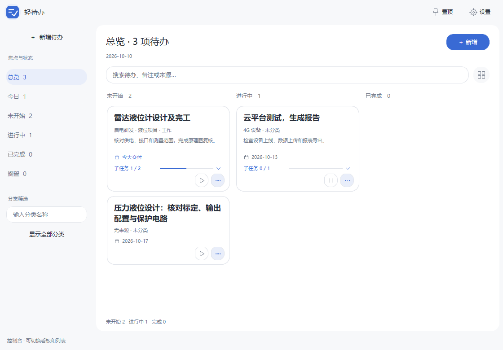

# LiteTodo · 轻待办

**把待办放在手边。轻量、离线、免安装的桌面任务管理工具。**

当前版本 **0.4.1** · Windows x64 程序约 **2.54 MB** · 无需账户 · 启动不联网

[下载 LiteTodo.exe](https://github.com/WSxuqinrui/LiteTodo/releases/download/v0.4.1/LiteTodo.exe) · [全部版本](https://github.com/WSxuqinrui/LiteTodo/releases) · [构建与数据说明](docs/development.md)

## 双击即用

在 Releases 下载 **LiteTodo.exe**，放到常用文件夹，双击即可使用，无需安装。任务自动保存在本机；升级时关闭程序并替换 EXE 即可。

首次使用可从「新增」开始；点击左上角软件图标，在快捷面板和控制台之间切换。右上角可设置置顶、主题、浮球、提醒和备份。

目前提供 Windows x64 可执行文件。Linux、macOS Intel 和 Apple Silicon 已通过自动构建、测试与打包，桌面实机体验仍待验收。

## 已实现的功能

| 功能 | 现在可以做什么 |
| --- | --- |
| 任务管理 | 新增、编辑、删除；开始/暂停、完成/恢复、加急、搁置；记录分类、来源和备注 |
| 快速查找 | 按今日、未开始、进行中、已完成、搁置筛选；搜索任务、备注及来源；按分类筛选 |
| 交付时间 | 今天、明天、后天、+3 天、+7 天快捷选项，内嵌月历选择日期；提醒时间独立设置 |
| 子任务 | 添加、改名、删除；主页面直接展开并勾选完成/恢复，实时显示完成数量和进度 |
| 控制台 | 展示状态看板或列表，集中查看来源、分类、备注及子任务；窄窗口自动调整布局 |
| 桌面浮球 | 数量样式或可爱「小团子」；支持拖动、贴边隐藏、悬停展开、双击开合及右键新增 |
| 提醒 | 到点提醒、测试通知、稍后 5 分钟；Windows 系统通知未显示时使用应用内提醒兜底 |
| 附件 | 拖文件到浮球生成草稿，保存时复制附件；保留原文件，支持查看附件路径 |
| 本地文本整理 | 粘贴文字，按行整理成任务，识别今天/明天/后天和加急；先预览，再批量保存 |
| 数据与备份 | 本地 SQLite 存储；手动备份、每日自动备份（保留最近 7 份）、导入/导出及目录迁移 |
| 个性化 | 跟随系统/浅色/深色、五种主题配色、透明度、紧凑卡片、置顶及托盘行为 |
| 快捷操作 | Ctrl+N 新增、Ctrl+F 搜索、Ctrl+Enter 保存、Esc 返回；Windows 可配置文本整理全局快捷键 |

## 使用特色

- **轻量原生界面**：C++17 + FLTK + SQLite，不依赖浏览器内核。发布打包检查程序和全部随包文件合计不超过 5,000,000 字节；这是磁盘体积目标。
- **一个窗口完成日常操作**：新增、编辑、日期、提醒、设置和确认都在当前主窗口内切换，保留未保存的任务草稿。
- **主页面就能推进任务**：加粗标题、常显开始/暂停按钮、更多操作菜单；展开子任务即可勾选，无需进入编辑页。
- **浮球会表达忙闲状态**：空闲时开心，待办达到 8 项时疲惫，有加急或逾期任务时冒火，进行中时认真。
- **数据留在本机**：无需登录和云服务。本地整理采用文本规则，使用前可核对预览结果。

子任务全部完成后，父任务仍由你主动完成；有未完成子项时不能完成父任务。提醒需要程序保持运行，退出程序后不会继续通知。

## 界面预览

以下为程序实际控件渲染，使用演示任务，不包含个人数据；窗口外框由操作系统提供。

### 快捷面板与任务编辑

| 主页面：直接完成子任务 | 编辑任务：快捷日期与子任务 |
| --- | --- |
|  |  |

### 控制台：集中查看任务状态

## 数据与升级

Windows 默认数据目录是 `%LOCALAPPDATA%\LiteTodoPrototype`。保留这个历史目录名是为了兼容早期版本，更新程序不会要求重新录入任务。可以在设置中更改数据目录，或使用 `--portable` 将数据存放到程序旁的 `data` 文件夹。

数据库备份包含任务与附件引用，换机时还需复制附件文件。建议升级前在「设置 → 数据与备份」执行一次备份。详细路径、迁移和恢复规则见[数据说明](docs/development.md#数据备份与升级)。

## 当前边界

云端同步、微信绑定、OCR、重复任务、回收站及「贴在桌面」暂未实现。macOS/Linux 的桌面通知、托盘及窗口行为仍需实机验收；自动构建通过不代表这些交互已经验收。当前任务查询与计数上限为 2000 条。

## 源码与参考

构建依赖、项目结构、测试方法及平台注意事项见[开发说明](docs/development.md)。第三方组件和许可原文见 [THIRD_PARTY_NOTICES.md](THIRD_PARTY_NOTICES.md)、[运行库许可](docs/licenses/)及 [FLTK 许可](https://www.fltk.org/COPYING.php)。

交互参考 [Pometodo](https://github.com/ShiliuX-Team/pometodo) 和用户提供的界面截图；程序代码与清单图标独立编写。交互对应关系见[参考说明](docs/interaction-reference.md)。
